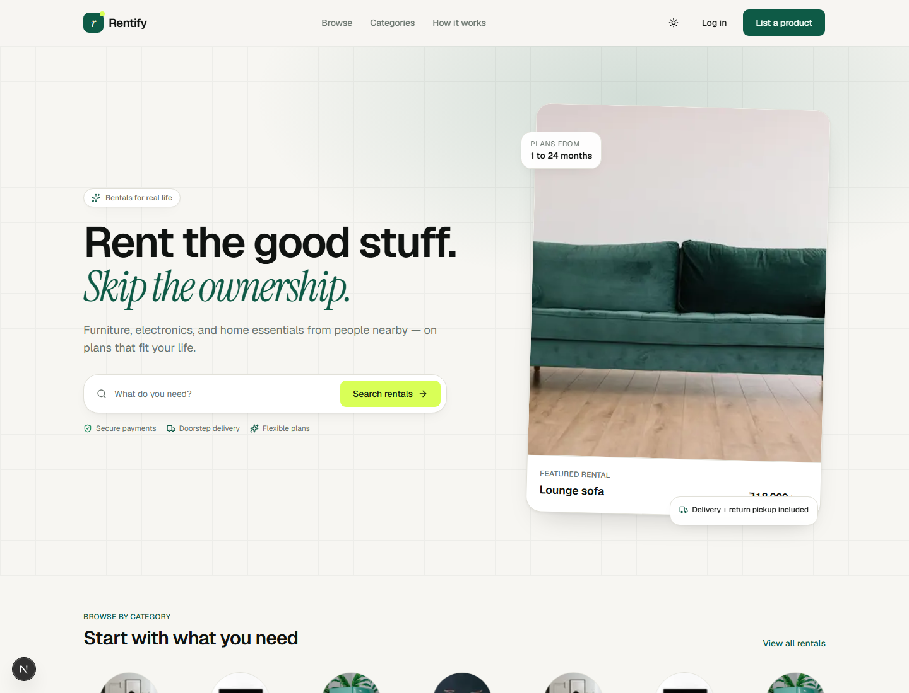
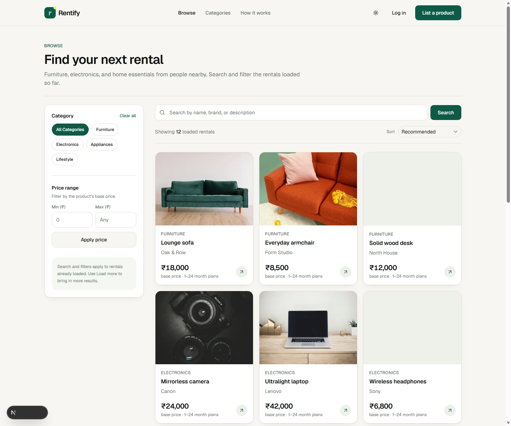
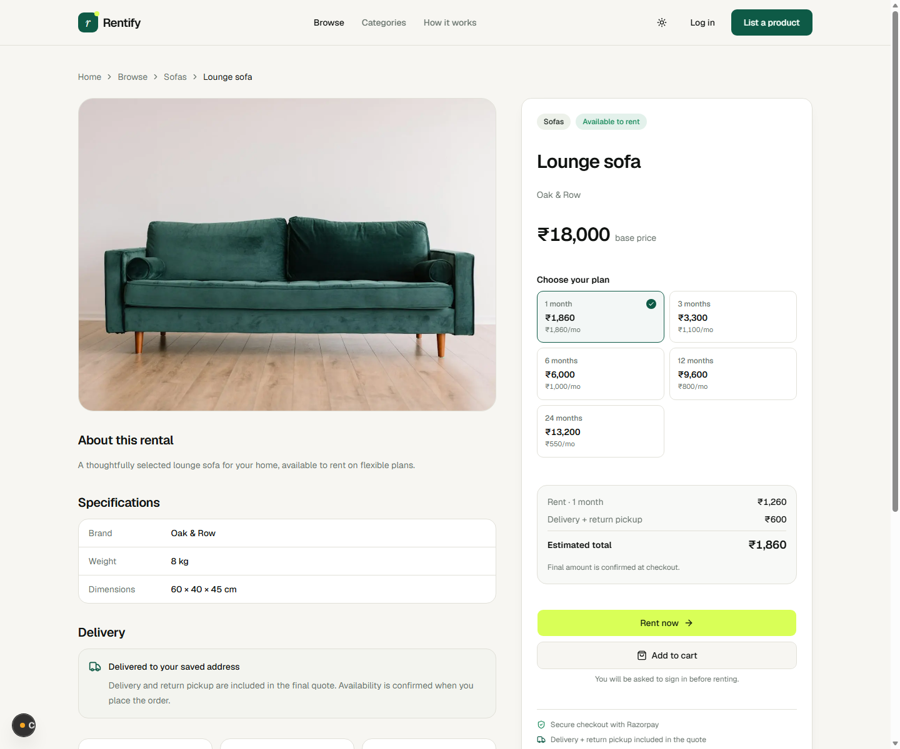
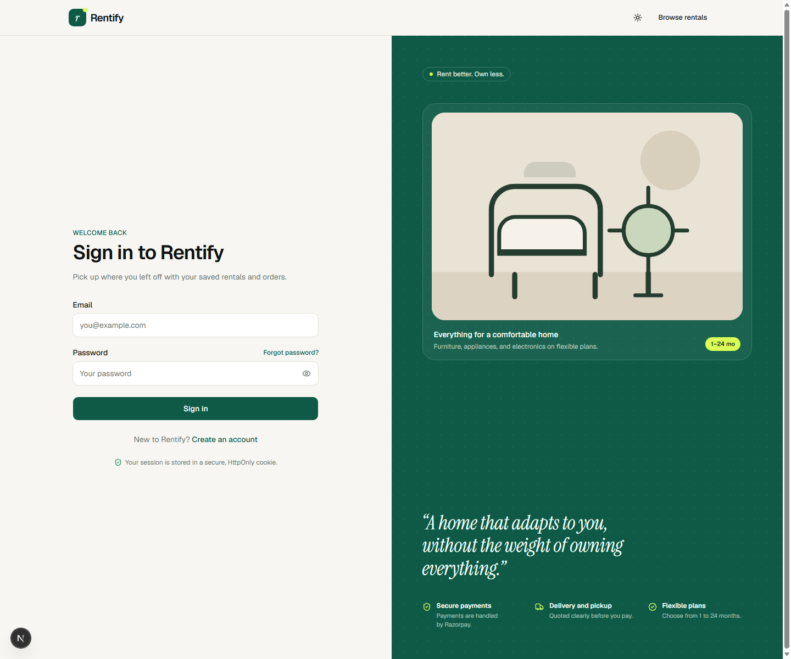
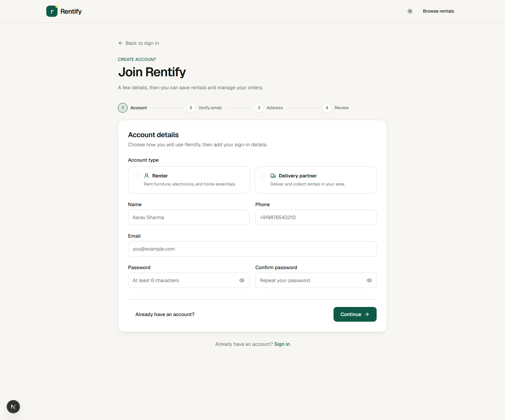
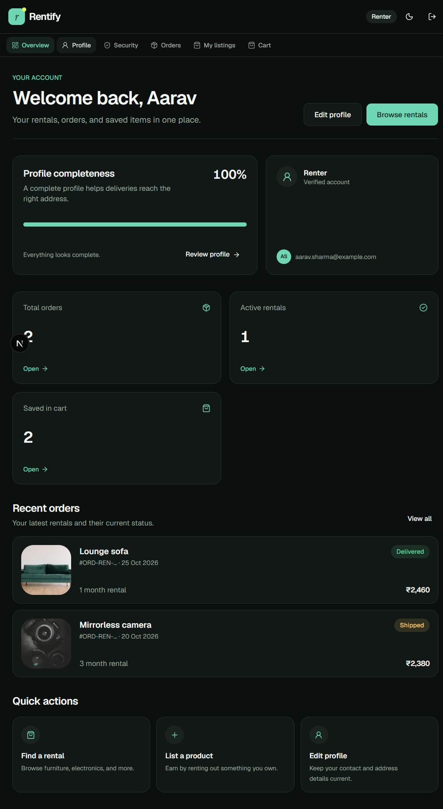

# Rentify

Rentify is an Indian peer-to-peer rental marketplace where people can rent furniture, electronics, and home essentials for a flexible period, while product owners can list items they are not using. The app also includes tools for renters, delivery partners, and administrators.

## Tech stack

- **Frontend:** Next.js App Router, React, TypeScript, Tailwind CSS, shadcn/ui
- **Data and forms:** TanStack Query, Axios, React Hook Form, Zod
- **Backend:** Node.js, Express, MongoDB, and Mongoose
- **Payments and images:** Razorpay and Cloudinary

## Screenshots

| Home | Browse rentals |
|---|---|
|  |  |

| Product details and rental plans | Sign in |
|---|---|
|  |  |

| Create an account |
|---|
|  |

| Your dashboard |
|---|
|  |

## Features

- Find furniture, electronics, and other useful items to rent.
- Check rental options and prices before you decide.
- Save items you like and keep track of your rentals in one place.
- Create an account, update your contact details, and manage your own listings.
- Get your rentals delivered, with clear information about delivery and returns.
- Delivery partners can see their upcoming deliveries, and administrators can keep rental categories up to date.
